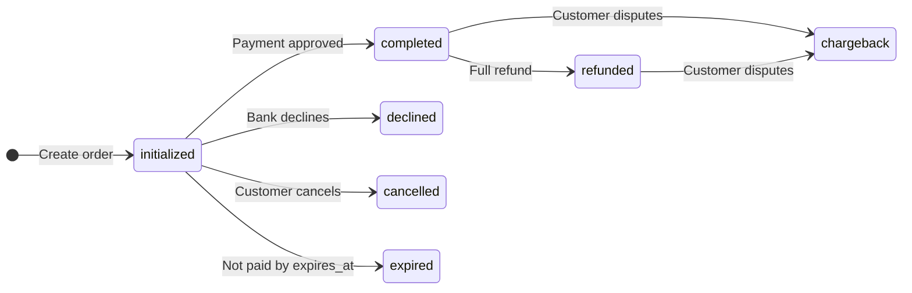

# Payment statuses

Every Paylark order has a `status` that shows where it is in the payment lifecycle. Fulfill an order only when its status is `completed`, and confirm that status with the API or a verified webhook, never from the customer's redirect alone.

## Lifecycle

An order starts as `initialized` and ends its payment attempt as `completed`, `declined`, `cancelled`, or `expired`. Only a `completed` order can change again, when you refund it or the customer disputes it.

## What each status means

| Status | Meaning | Payment attempt over? | What to do |
|---|---|---|---|
| `initialized` | The order exists, and the customer hasn't finished paying. | No | Wait for a webhook. Don't fulfill. |
| `completed` | The payment succeeded. | Yes | Fulfill the order. |
| `declined` | The customer's bank or Paylark's fraud checks refused the payment. | Yes | Ask the customer to pay with another method. Create a new order. |
| `cancelled` | The customer left the payment page with the cancel button. | Yes | Keep the cart so the customer can try again. |
| `expired` | The customer didn't pay before `expires_at`, one hour after the order was created. | Yes | Treat the order as unpaid. |
| `refunded` | You refunded the full amount. | Yes | Update the order in your system. |
| `chargeback` | The customer disputed the payment with their bank. | Yes | Respond to the dispute. Paylark contacts you by email. |

!!! note "Partial refunds"
    A partial refund doesn't change the status. The order stays `completed`, and `amount_refunded` shows how much you've refunded so far. The status becomes `refunded` only when `amount_refunded` equals `amount`.

## How to track status changes

Use both of these, in this order:

1. **Webhooks.** Paylark sends an `order.status_changed` event to your `notification_url` every time the status changes. This is the reliable signal: it arrives even if the customer closes their browser before returning to your site.
2. **Get an order.** Before you fulfill, call [`GET /orders/{order_id}`](reference/index.md) to confirm the current status.

!!! warning "Don't trust the redirect"
    When the payment attempt ends, Paylark sends the customer to your `redirect_urls.success` page, whether the payment was approved or declined. The redirect only means the customer is back on your site, not that they paid. Always check the status before you show a confirmation or ship anything.

## Testing each status

In the test environment, the card number you enter on the payment page decides the result:

| Card number | Result |
|---|---|
| `4111 1111 1111 1111` | `completed` |
| `4000 0000 0000 0002` | `declined` |

Use any future expiry date and any three-digit security code. To test `cancelled`, click **Cancel** on the payment page. To test `expired`, leave the payment page open for longer than one hour.
