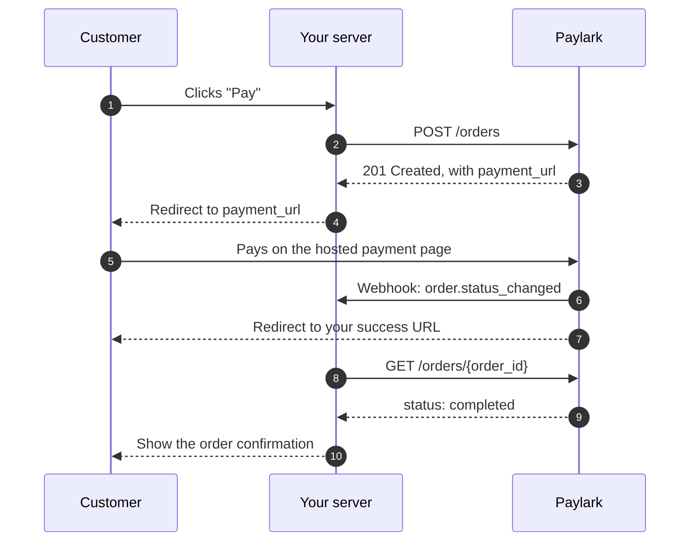

# Quickstart: accept your first payment

This guide takes you from a test API key to a completed test payment in about 15 minutes. You'll create an order, send the customer to the Paylark payment page, and confirm the result.

## Before you begin

You need:

- A Paylark test API key. It starts with `sk_test_`.
- A server that can make HTTPS requests. The examples use curl and PowerShell; any language with an HTTP client works.
- A URL on your server that can receive webhooks. For local testing, the [Postman collection and mock server](index.md#where-to-start) let you try every request without a public URL.

!!! tip "Keep your key on the server"
    Your secret key can create orders and refunds. Never put it in browser code, a mobile app, or a public repository.

## How the payment flow works



The customer enters their card details on Paylark's page, so your server never handles card data.

## Step 1: Create an order

Send the amount, the currency, and the URLs Paylark needs to send the customer back and notify you. `order_id` is your own reference, and it must be unique.

=== "curl"

    ```bash
    curl -X POST https://api.test.paylark.example/v1/orders \
      -H "Authorization: Bearer $PAYLARK_API_KEY" \
      -H "Content-Type: application/json" \
      -d '{
        "order_id": "shop-10045",
        "amount": 4995,
        "currency": "EUR",
        "description": "Running shoes, size 42",
        "redirect_urls": {
          "success": "https://shop.example/checkout/thank-you",
          "cancel": "https://shop.example/checkout/cart"
        },
        "notification_url": "https://shop.example/webhooks/paylark"
      }'
    ```

=== "PowerShell"

    ```powershell
    $headers = @{ Authorization = "Bearer $env:PAYLARK_API_KEY" }
    $body = @{
        order_id         = "shop-10045"
        amount           = 4995
        currency         = "EUR"
        description      = "Running shoes, size 42"
        redirect_urls    = @{
            success = "https://shop.example/checkout/thank-you"
            cancel  = "https://shop.example/checkout/cart"
        }
        notification_url = "https://shop.example/webhooks/paylark"
    } | ConvertTo-Json

    Invoke-RestMethod -Method Post -Uri "https://api.test.paylark.example/v1/orders" `
        -Headers $headers -ContentType "application/json" -Body $body
    ```

!!! info "Amounts are in cents"
    `amount` is an integer in the currency's smallest unit. `4995` means €49.95. Sending `49.95` returns an error.

Paylark responds with `201 Created` and the new order:

```json
{
  "id": "ord_7Hq2KxN4Vb",
  "order_id": "shop-10045",
  "status": "initialized",
  "amount": 4995,
  "amount_refunded": 0,
  "currency": "EUR",
  "description": "Running shoes, size 42",
  "payment_url": "https://pay.test.paylark.example/p/ord_7Hq2KxN4Vb",
  "created_at": "2026-10-15T10:24:31Z",
  "updated_at": "2026-10-15T10:24:31Z",
  "expires_at": "2026-10-15T11:24:31Z"
}
```

!!! tip "If the request times out"
    Retry with the same `order_id`. If the first request did create the order, Paylark returns `409 Conflict` with `order_id_already_exists` instead of creating a duplicate. Then call [Get an order](#step-4-confirm-the-status) to continue.

## Step 2: Redirect the customer

Send the customer's browser to `payment_url`. For example, return an HTTP `303 See Other` response with `payment_url` in the `Location` header.

The customer has until `expires_at`, one hour, to pay. After that, the order becomes `expired`.

## Step 3: Pay with a test card

On the payment page, enter:

- Card number: `4111 1111 1111 1111`
- Expiry date: any date in the future
- Security code: any three digits

Paylark approves the payment and sends the customer back to your success URL. To test a declined payment instead, use `4000 0000 0000 0002`. See [Payment statuses](payment-statuses.md#testing-each-status) for every test case.

## Step 4: Confirm the status

At the same time, Paylark sends an `order.status_changed` webhook to your `notification_url`. Whether you start from the webhook or from the customer's return, confirm the status before you fulfill:

=== "curl"

    ```bash
    curl https://api.test.paylark.example/v1/orders/shop-10045 \
      -H "Authorization: Bearer $PAYLARK_API_KEY"
    ```

=== "PowerShell"

    ```powershell
    Invoke-RestMethod -Uri "https://api.test.paylark.example/v1/orders/shop-10045" `
        -Headers @{ Authorization = "Bearer $env:PAYLARK_API_KEY" }
    ```

If `status` is `completed`, the payment succeeded. Fulfill the order.

## Next steps

- Learn what every status means and how to handle it: [Payment statuses](payment-statuses.md).
- Explore every field and error: [API reference](reference/index.md).
- Before you go live, swap your test key for a live key (`sk_live_`) and the base URL for `https://api.paylark.example/v1`.
