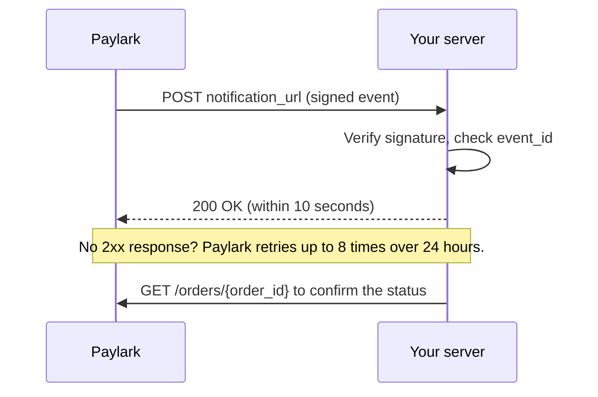

# Webhooks

Paylark sends a webhook to your server every time an order's status changes. Verify each webhook's signature before you trust it, respond with a `2xx` status within 10 seconds, and expect the same event more than once.

## How delivery works

When an order's status changes, Paylark sends an HTTPS `POST` request to the `notification_url` you set when you created the order.



- **Respond quickly.** Return `200` as soon as you've verified and stored the event. Do slow work, like sending emails or updating stock, afterwards.
- **Retries.** If Paylark doesn't get a `2xx` response within 10 seconds, it retries up to 8 times over 24 hours.
- **Duplicates.** Because of retries, the same event can arrive more than once.

## Event payload

Every webhook has the same shape:

```json
{
  "event_id": "evt_9Rw4Tz6Y",
  "type": "order.status_changed",
  "created_at": "2026-10-15T10:26:02Z",
  "data": {
    "id": "ord_7Hq2KxN4Vb",
    "order_id": "shop-10045",
    "status": "completed",
    "previous_status": "initialized",
    "amount": 4995,
    "currency": "EUR"
  }
}
```

| Field | Description |
|---|---|
| `event_id` | Unique ID for this event. Use it to ignore duplicates. |
| `type` | Always `order.status_changed`. |
| `data.status` | The order's new status. See [Payment statuses](payment-statuses.md). |
| `data.previous_status` | The status before this change. |

## Verify the signature

Anyone can send a request to your `notification_url`, so a webhook isn't proof by itself that a payment happened. Paylark signs every webhook with your **webhook signing secret**, and includes the signature in the `Paylark-Signature` header:

```
Paylark-Signature: t=1792060000,v1=5f2b8c0e4a1d9f7b3c6e2a8d0b4f1e7c9a3d5b8e2f6c0a4d7b1e9f3c5a8d2b6e
```

- `t` is the Unix timestamp when Paylark signed the request.
- `v1` is an HMAC-SHA256 signature, in hexadecimal.

To verify a webhook:

1. Read the **raw request body**, exactly as received. Don't parse and re-encode the JSON first: any change, even a space, changes the signature.
2. Split the header into `t` and `v1`.
3. Reject the event if `t` is more than 5 minutes from the current time. This stops an attacker from replaying an old webhook.
4. Build the signed payload: the timestamp, a period, and the raw body: `{t}.{raw body}`.
5. Compute an HMAC-SHA256 of the signed payload, using your signing secret as the key.
6. Compare your result with `v1` using a constant-time comparison. If they don't match, reject the event with `400`.

=== "Python"

    ```python
    import hashlib
    import hmac
    import time

    def verify_signature(raw_body: bytes, header: str, secret: str, tolerance: int = 300) -> bool:
        try:
            parts = dict(item.split("=", 1) for item in header.split(","))
            timestamp, received = parts["t"], parts["v1"]
        except (KeyError, ValueError):
            return False

        if abs(time.time() - int(timestamp)) > tolerance:
            return False

        signed_payload = timestamp.encode() + b"." + raw_body
        expected = hmac.new(secret.encode(), signed_payload, hashlib.sha256).hexdigest()
        return hmac.compare_digest(expected, received)
    ```

=== "Node.js"

    ```javascript
    const crypto = require("crypto");

    function verifySignature(rawBody, header, secret, toleranceSeconds = 300) {
      const parts = Object.fromEntries(header.split(",").map((item) => item.split("=")));
      const timestamp = parts.t;
      const received = parts.v1;
      if (!timestamp || !received) return false;

      if (Math.abs(Date.now() / 1000 - Number(timestamp)) > toleranceSeconds) return false;

      const expected = crypto
        .createHmac("sha256", secret)
        .update(`${timestamp}.${rawBody}`)
        .digest("hex");

      return expected.length === received.length &&
        crypto.timingSafeEqual(Buffer.from(expected), Buffer.from(received));
    }
    ```

!!! warning "Keep your signing secret safe"
    Your webhook signing secret is different from your API key. Store it on your server, for example in an environment variable, and never put it in browser code or a public repository.

!!! tip "Why a constant-time comparison?"
    A normal string comparison stops at the first character that differs, so its timing can leak how much of a guessed signature is correct. `hmac.compare_digest` and `crypto.timingSafeEqual` always take the same time.

## Handle duplicates and ordering

- **Store each `event_id` you process.** If an event arrives with an ID you've already seen, respond `200` and do nothing else.
- **Don't rely on arrival order.** Retries can make an older event arrive after a newer one. Before you fulfill or update an order, call [Get an order](reference/index.md) and act on its current status.

## Test webhooks locally

The portfolio repository includes two small Python scripts in [`examples/webhooks`](https://github.com/SantiUlibarri/tech-writing-portfolio/tree/main/examples/webhooks). They use only the Python standard library, so there's nothing to install.

1. In one terminal, start the receiver:

    ```bash
    python3 examples/webhooks/receiver.py
    ```

2. In a second terminal, send a signed test event:

    ```bash
    python3 examples/webhooks/send_test_webhook.py
    ```

    The receiver prints `✓ Verified evt_…: order shop-10045 initialized → completed`.

3. Try the failure cases:

    | Command | What it simulates | Receiver result |
    |---|---|---|
    | `send_test_webhook.py --tamper` | The body was changed after signing | `✗ Rejected`, `400` |
    | `send_test_webhook.py --expired` | An old webhook replayed 10 minutes later | `✗ Rejected`, `400` |
    | `send_test_webhook.py --duplicate` | Paylark retried the same event | Second copy: `↺ Duplicate`, `200` |

## Troubleshooting

| Symptom | Likely cause | Fix |
|---|---|---|
| Every signature fails | Your framework parsed the JSON before you verified it | Verify against the raw body bytes |
| Every signature fails | Wrong secret, or a test secret used with live events | Check the webhook signing secret for the environment |
| Signatures fail only sometimes | Your server's clock is wrong | Sync the clock, for example with NTP |
| Paylark keeps retrying | Your endpoint takes longer than 10 seconds, or returns a non-`2xx` status | Respond `200` first, then do slow work in the background |
| An order is fulfilled twice | Duplicate events processed twice | Store and check `event_id` |
